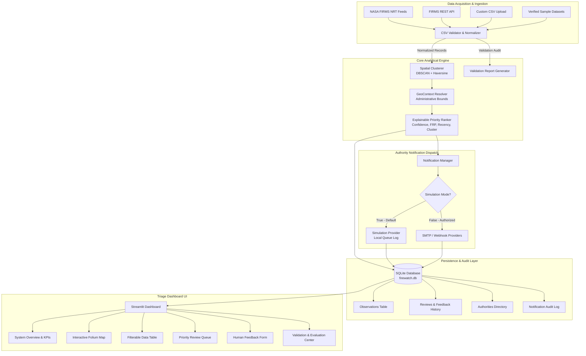

# FireWatch AI 🛰️🔥
### Satellite-Based Active Fire Observation Triage Dashboard

[](https://www.python.org/)
[](https://streamlit.io/)
[](https://python-visualization.github.io/folium/)
[](https://www.sqlite.org/)
[](https://pytest.org/)
[](LICENSE)

---

## ⚠️ Important Operating Disclaimer & Scope

> **FireWatch AI is an observation-triage and decision-support system, NOT a confirmed wildfire detector or an emergency dispatch system.**
>
> Satellite active fire thermal anomaly detections:
> 1. Are **NOT** ground-truth confirmations of wildfires. Thermal anomalies may represent controlled agricultural burning, industrial heat sources (e.g. refineries, gas flares, smelters), hot bare ground, or false alarms.
> 2. May be obscured or delayed by cloud cover, heavy tree canopy, or satellite orbit revisit schedules.
> 3. Priority scores provide a **review-ranking aid** for human analysts; they do **NOT** indicate actual wildfire severity or fire spread rate.
> 4. This system does **NOT** replace trained forest rangers, firefighters, or emergency responders.
> 5. **Simulation Mode** is active by default. No external emergency agencies are contacted without explicit authorization and verified directory configuration.

---

## 1. Problem Statement & Objective

Earth observation satellites (e.g., NASA Terra, Aqua, Suomi-NPP, NOAA-20, NOAA-21) detect thousands of thermal anomalies globally every day via the Fire Information for Resource Management System (FIRMS). Forest management and disaster response teams face an information overload: which detections represent probable spreading fires requiring rapid human verification, and which are isolated, low-confidence, or industrial heat sources?

**FireWatch AI** solves this by providing:
- Structured ingestion, strict validation, and normalization of NASA FIRMS CSV data (MODIS & VIIRS).
- **Explainable priority scoring** with human-readable rationales and explicit uncertainty limitations.
- Spatial grouping of nearby thermal anomalies using **Haversine DBSCAN clustering**.
- Location-aware association with verified administrative jurisdictions.
- Persistent **human-in-the-loop review** with correction tracking and tamper-evident SQLite audit trails.
- Configurable **authority notification workflow** with strict duplicate throttling and simulation defaults.
- End-to-end reproducible testing and comprehensive CSV/JSON export capabilities.

---

## 2. System Architecture



---

## 3. Technology Stack

- **Language & Runtime**: Python 3.11+
- **Interactive UI**: Streamlit 1.35+
- **Geospatial Mapping**: Folium & Streamlit-Folium
- **Data Engineering**: Pandas, NumPy
- **Interactive Charts**: Plotly Express & Plotly Graph Objects
- **Spatial Machine Learning**: Scikit-learn (DBSCAN with Haversine distance metric)
- **Data Validation & Schemas**: Pydantic v2
- **Persistent Storage**: SQLite 3 with parameterized relational schema and audit history
- **Automated Testing**: Pytest 8.0+
- **HTTP / Telemetry Acquisition**: Requests

---

## 4. NASA FIRMS Data Sources & Attribution

This application consumes active fire data provided by NASA's Fire Information for Resource Management System (FIRMS):

- **MODIS C6.1 (Terra and Aqua)**: 1 km spatial resolution, numeric confidence (0–100%), Fire Radiative Power (MW), brightness temperatures.
- **VIIRS C2 (Suomi-NPP & NOAA-20/21)**: 375 m spatial resolution, categorical confidence (`low`, `nominal`, `high`), I-band 4 and 5 brightness temperatures, FRP (MW).

### Data Attribution:
> *"We acknowledge the use of data and imagery from LANCE FIRMS operated by NASA's Earth Science Data and Information System (ESDIS) with funding provided by NASA/HQ."*
> NASA Open Data Policy: Public domain, open for scientific and commercial decision support.
> FIRMS Portal: https://firms.modaps.eosdis.nasa.gov/

---

## 5. Explainable Priority Ranking

Priority scores $S \in [0.0, 1.0]$ are calculated using a transparent, multi-factor linear composite model with non-linear saturation transforms:

$$S = w_c \cdot S_{\text{conf}} + w_f \cdot S_{\text{frp}} + w_r \cdot S_{\text{rec}} + w_s \cdot S_{\text{cluster}} + w_m \cdot S_{\text{repeat}}$$

Where weights $\sum w_i = 1.0$ (default: $w_c=0.25, w_f=0.30, w_r=0.20, w_s=0.15, w_m=0.10$):

1. **Confidence Score ($S_{\text{conf}}$)**: Scaled satellite detection confidence ($[0.0, 1.0]$).
2. **FRP Saturation ($S_{\text{frp}}$)**: Modeled using $1 - e^{-\text{FRP} / \text{FRP}_{\text{ref}}}$ (reference: 50.0 MW). Missing FRP is explicitly handled using a neutral baseline of 0.35 and logged in the limitations.
3. **Temporal Recency ($S_{\text{rec}}$)**: Exponential decay $e^{-\Delta t / \text{Window}}$ relative to the most recent dataset observation (reference window: 48 hours).
4. **Spatial Cluster Size ($S_{\text{cluster}}$)**: Scaled density score from DBSCAN cluster size ($\min(1.0, (N - 1) / 7.0)$).
5. **Corroborating Repeats ($S_{\text{repeat}}$)**: Multi-point corroborate count ($\min(1.0, R / 5.0)$).

### Triage Levels:
- **High Review Priority**: Score $\ge 0.70$
- **Medium Review Priority**: $0.40 \le \text{Score} < 0.70$
- **Low Review Priority**: Score $< 0.40$

---

## 6. Installation & Quick Start

### Prerequisites
- Python 3.11 or higher
- Git

### 1. Clone the Repository
```bash
git clone https://github.com/jitendradurgaprasad/VyomTech.git
cd VyomTech
```

### 2. Set Up Virtual Environment (Recommended)
```bash
python -m venv venv
# On Windows:
.\venv\Scripts\activate
# On Linux/macOS:
source venv/bin/activate
```

### 3. Install Dependencies
```bash
pip install -r requirements.txt
```

### 4. Configure Environment
Copy the example environment template:
```bash
copy .env.example .env     # Windows
cp .env.example .env       # Linux/macOS
```
*Note: Simulation mode is enabled (`NOTIFICATION_SIMULATION_MODE=True`) by default.*

### 5. Launch the Dashboard

**On Windows (One-Click Launch):**
Simply double-click `run.bat` in the project root, or execute:
```cmd
run.bat
```
*(This automatically verifies Python, checks and installs any missing dependencies, initializes `.env`, and launches the dashboard.)*

**Or via Terminal / PowerShell:**
```bash
streamlit run app.py
```
Open your browser at `http://localhost:8501`.

---

## 7. Running the Automated Test Suite

Run all automated unit, integration, and security tests:
```bash
pytest -v
```

### Verification Results:
All 28 tests pass deterministically across 8 test suites:
- `tests/test_automation.py` (2 tests): Autonomous fire pipeline, satellite optical snapshot generation, email dispatch routing.
- `tests/test_validator.py` (9 tests): CSV structure, coordinate bounds, date/time parsing, missing fields, duplicates, synthetic edge cases.
- `tests/test_priority.py` (4 tests): Score determinism, missing FRP fallback, threshold tiers, configurable weights.
- `tests/test_clustering.py` (3 tests): Haversine distance, DBSCAN spatial grouping, cluster metrics preservation.
- `tests/test_feedback.py` (1 test): SQLite feedback persistence, review history, correction flags.
- `tests/test_notifications.py` (4 tests): Message construction, simulation isolation, duplicate cooldown throttling, SMTP failure safety.
- `tests/test_context.py` (3 tests): Administrative bounds matching, non-fabrication fallback to "Jurisdiction unknown".
- `tests/test_privacy_security.py` (2 tests): Secret masking, no hardcoded API keys or passwords.

---

## 8. Dashboard Feature Walkthrough

| View | Purpose |
| :--- | :--- |
| **⚡ Autonomous Fire Monitor** | One-click autonomous monitor: Ingests NASA satellite stream, detects active fires, generates optical satellite image snapshots with crosshair overlays, and automatically routes/dispatches alerts to the nearest emergency authority email (`mjdp8086@gmail.com`). |
| **System Overview** | High-level operational metrics (total observations, high-priority counts, pending reviews, simulated alerts), live disclaimer, and distribution charts. |
| **Data Ingestion & Import** | Load built-in genuine MODIS/VIIRS samples, fetch live NASA FIRMS feeds, upload custom CSVs, or run synthetic edge cases. |
| **Interactive Map & Table** | Folium interactive geospatial map with priority-colored circle markers, detailed telemetry popups, cluster layer toggle, and synchronized filterable table. |
| **Priority Review Queue** | Triage queue sorted descending by priority score. Displays plain-English explanation rationales and sensor limitations for every detection. |
| **Observation Details & Review** | Deep-dive telemetry inspection and human feedback form. Records analyst assessment, confidence, notes, and preserves correction history. |
| **Authority Feedback & Site Memory** | Manually records an authority outcome with its case reference. A verified, high-confidence non-wildfire outcome can suppress repeat notifications for that exact six-decimal coordinate for 30 days; the observation remains visible. |
| **Global Feedback History** | Global audit log of all analyst assessments across the system, status distributions, and CSV export. |
| **Authority Directory** | Configurable directory of regional and national emergency review desks. Clearly labels pre-seeded records as `TEST DATA`. |
| **Notification Centre** | Chronological notification audit log (Queued, Simulated, Provider Accepted, Delivered, Failed) with full JSON payload inspection and CSV export. |
| **Data Validation Report** | Downloadable quality audit report of ingested data showing total, valid, rejected, duplicate rows, missing fields, and row-by-row reasons. |
| **Evaluation & Testing** | In-app interactive test runner allowing one-click execution of the Pytest suite with real output logs and test coverage summary. |
| **Settings & About** | Dynamic configuration of priority weights, reference parameters, clustering epsilon, simulation mode toggle, and NASA attribution. |

---

## 9. Notification Workflow & Simulation Safety

```
[Observation Exceeds Priority (Score >= 0.70) or Escalated]
                            │
                            ▼
           [Exact-Coordinate Feedback Memory]
             ├── Active matching memory? ──> [Notification skipped; detection stays visible]
             └── No exact match / expired?
                            │
                            ▼
           [Duplicate Check (60-min Cooldown)]
                   ├── Recently Notified? ──> [Throttled & Skipped]
                   └── New Detection?
                            │
                            ▼
          [Location & Jurisdiction Resolution]
                   ├── Inside Known Bounds? ──> [Regional Authority Desk]
                   └── Outside / Unknown?   ──> [Central Review Queue]
                            │
                            ▼
                 [Notification Dispatcher]
                   ├── Simulation Mode (DEFAULT) ──> [Safe Local Queue Log]
                   └── Authorized Mode           ──> [Verified SMTP / Webhook]
```

### Safety Rules:
- **Default Simulation Mode**: All notifications default to simulation mode (`NOTIFICATION_SIMULATION_MODE=True`).
- **Standardized Review Notice**: Every notice states in capital letters:
  `* THIS IS AN UNVERIFIED SATELLITE THERMAL DETECTION.`
  `* NOT A CONFIRMED WILDFIRE OR EMERGENCY DISPATCH EVENT.`
- **Actionable Verification Steps**: Includes recommended ground checks (meteorological check, land-use cross-reference, ranger dispatch).
- **Duplicate Protection**: Observations are throttled to prevent notification spam within a configurable 60-minute window.
- **Authority feedback is manual**: FireWatch has no authority inbox/API integration. Operators record a reply in **Authority Feedback & Site Memory** and attest that its source was checked through a known official contact. The app does not claim to authenticate replies or retrain model weights.
- **Narrow repeat-notification memory**: Only high-confidence verified responses marked as an authorized/prescribed burn, known non-fire thermal source, or false satellite anomaly may create a memory, and only with a case/reference. It matches the same latitude/longitude rounded to six decimal places (about 0.1 m in latitude), has no geographic radius, expires after 30 days, and suppresses notifications only. Detections remain in the map and review queue. High-confidence verified confirmed-wildfire feedback clears active memory at that exact coordinate.

---

## 10. Data Privacy & Security

- **No Secrets in Source Control**: `.env` and SQLite database files (`*.db`) are strictly excluded via `.gitignore`.
- **Credential Masking**: Any SMTP or webhook errors automatically redact sensitive passwords or keys before saving to logs.
- **Non-Fabrication Policy**: Synthetic test datasets are strictly labelled (`SYNTHETIC_SENSOR`, `SYNTHETIC_TEST_CASES`). Detections outside known administrative boundaries are honestly categorized as `Jurisdiction unknown`.

---

## 11. Troubleshooting

| Issue | Resolution |
| :--- | :--- |
| `folium` or `streamlit-folium` missing | Run `pip install folium streamlit-folium` |
| Port 8501 already in use | Run `streamlit run app.py --server.port 8502` |
| Live NASA FIRMS feed fails with network timeout | Check your internet connection. If behind an enterprise proxy, use the pre-loaded genuine samples in `data/sample/`. |
| NASA FIRMS REST API requires MAP_KEY | Obtain a free instant key from https://firms.modaps.eosdis.nasa.gov/api/map_key/ and set `FIRMS_MAP_KEY` in `.env`. |

---

## 12. License

Distributed under the **MIT License**. See [LICENSE](LICENSE) for full details.
NASA FIRMS active fire datasets are provided under the NASA Open Data Policy.
